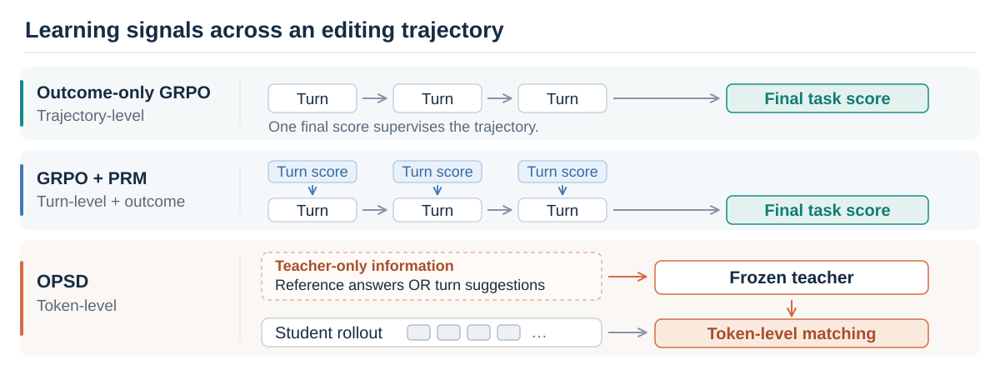

<div align="center">

# When Fine-Grained Credit Assignment Helps and Hurts
### Multimodal Agentic Reinforcement Learning through Video Editing

**[Lei Zhao](mailto:leizhao7@upenn.edu)<sup>1</sup> · [Zongheng Cao](mailto:tom@philolabs.ai)<sup>2</sup> · [Xinyu Hu](mailto:christine@philolabs.ai)<sup>2</sup>**

<sup>1</sup> University of Pennsylvania &nbsp;&nbsp; <sup>2</sup> Philo Labs

[Overview](#overview) · [Findings](#what-we-learn) · [Quick start](#quick-start) · [Documentation](#documentation) · [Citation](#citation)

</div>

**When does feedback on intermediate actions help an editing agent—and when does it hurt task completion?** We study trajectory-, turn-, and token-level learning signals across four movie-trailer editing tasks that combine visual inspection, reasoning, and tool use.

<p align="center">
  
</p>

> **Repository status:** This is a research source snapshot in release preparation. Local source checks and selected CPU tests are available; a complete GPU training build and end-to-end reproduction have not yet been verified. [What is included and what remains →](docs/release_status.md)

## Overview

The task types reflect different decisions in a real editing workflow. They are **constructed independently**: one task's output is not used to initialize the next.

| Task | Editing decision | Internal stage |
| :--- | :--- | :--- |
| **CS** · Content Selection | Select relevant shots from a candidate pool. | `s_1` |
| **NS** · Narrative Sequencing | Arrange selected shots into a coherent sequence. | `s_2` |
| **RC** · Rough Cut | Set each clip's in- and out-points within a fixed sequence. | `s_3` |
| **FC** · Fine Cut | Select and trim dialogue, place music, choose transitions, and render the result. Picture and timing stay fixed. | `s_4e` |

The earlier `s_4` construction stage is an intermediate representation, not the paper's Fine Cut task. See the [construction guide](docs/data_construction.md) for task interfaces and prerequisites.

## What we learn

- **When it helps.** In our experiments, decaying process rewards provides the largest benefit on Fine Cut. Outcome-only GRPO remains competitive on the three shorter-horizon task types. Task demands, scoring criteria, and horizon vary together, so this comparison does not isolate a causal effect of horizon.
- **When it hurts.** With a fixed process-reward weight, judge-preferred intermediate behaviors can increase while task completion and outcome scores decline. Reducing that weight to zero mitigates this pattern in our GRPO+PRM experiments.
- **Dense feedback is not sufficient.** OPSD is sensitive to the teacher's privileged information. Teacher–student disagreement and gradient statistics reveal contrasting failure patterns; effective remedies remain an open question.

These process-reward findings concern **LLM-judged turn-level rewards in our GRPO+PRM setup**. They do not establish the behavior of untested methods such as GiGPO or Turn-PPO. The full experimental context and implementation limits are summarized in the [experiment notes](docs/experiment_notes.md).

<p align="center">
  
</p>

*Conceptual schematics, not experimental plots. Both illustrations use hand-authored vectors and contain no film frames or task instances.*

## Quick start

Start with **local source verification**. These commands need Python 3.12 and the standard library; they do not train a model, contact a judge, or allocate a GPU.

```sh
git clone https://github.com/leizhao7/video-editing-credit-assignment.git
cd video-editing-credit-assignment

python3 scripts/check_release.py
PYTHONDONTWRITEBYTECODE=1 python3 -m unittest discover -s tests -p 'test_release_tools.py'
```

The source check verifies syntax, source hashes, symlinks, and excluded artifact types. The tests exercise source assembly, manifest validation, and patch verification with temporary synthetic fixtures. Neither check establishes that the full training stack is installed or that benchmark scores can be reproduced.

**Next:** choose a component below. Its guide describes dependencies, supported checks, and the remaining runtime requirements.

## Documentation

| I want to… | Guide | Source |
| :--- | :--- | :--- |
| Construct editing tasks from my own authorized media | [Data construction](docs/data_construction.md) | [`data_construction/`](data_construction/) |
| Inspect GRPO and fixed/decayed process rewards | [Training](docs/training.md) | [`training/`](training/) |
| Inspect token-level self-distillation and teacher inputs | [OPSD](docs/opsd.md) | [`opsd/`](opsd/) |
| Understand outcome grading and aggregation | [Evaluation](docs/evaluation.md) | [`evaluation/`](evaluation/) |
| Find recorded settings and dependency identities | [Experiment notes](docs/experiment_notes.md) | [`configs/`](configs/) |
| Check reproduction gaps and release boundaries | [Release status](docs/release_status.md) | [`scripts/check_release.py`](scripts/check_release.py) |

<details>
<summary><strong>Repository map</strong></summary>

```text
data_construction/   Task-building utilities, adapters, and generic prompts
training/            Fixed-PRM source, separate decay overlay, and CPU tests
opsd/                Forward-KL recipe, teacher-input code, and adapters
evaluation/          Outcome graders and a separate decay overlay
configs/             Recorded settings, dependency pins, and source hashes
docs/                Component guides and editable SVG illustrations
scripts/             Dependency-free source verification
tests/               Synthetic tests for release tools
```

</details>

## Data and reproducibility

We intend to release **code and the data-construction workflow**, not the dataset. This repository contains no film media, generated task instances, reference answers, cached trajectories, model checkpoints, or benchmark result files. The documentation illustrations are synthetic schematics.

To construct new tasks, supply media you are authorized to process and set `VIDEO_EDITING_DATA_ROOT` to a private directory outside this checkout. Paths and optional cloud resources are described in [`data_construction/environment.example`](data_construction/environment.example). Rebuilding tasks from different media will not reproduce the original dataset or numerical results exactly.

The paper's four evaluation repetitions are **not four independent training seeds**. Recorded configurations and upstream commit IDs also do not reconstruct the original modified training environment. The missing environment builds, launch services, reference-answer OPSD snapshot, and final filtering/sampling procedure are tracked in [release status](docs/release_status.md).

## Citation

Author and software metadata are available in [`CITATION.cff`](CITATION.cff). A formal paper link and publication citation will be added when available.

Part of this work was completed while Lei Zhao was an intern at Philo Labs. For questions, contact [Lei Zhao](mailto:leizhao7@upenn.edu), [Zongheng Cao](mailto:tom@philolabs.ai), or [Xinyu Hu](mailto:christine@philolabs.ai).

## Acknowledgments and licensing

The implementation builds on OpenCode, SkyRL, vLLM, and Qwen3.5-9B. Exact identities are recorded in [`configs/dependency_pins.json`](configs/dependency_pins.json); local modifications must be considered alongside those pins. Retain the included upstream notices when reusing their code. The license for this project's own code remains to be finalized.
