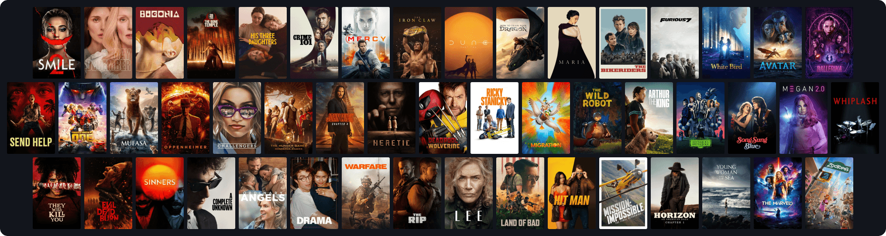
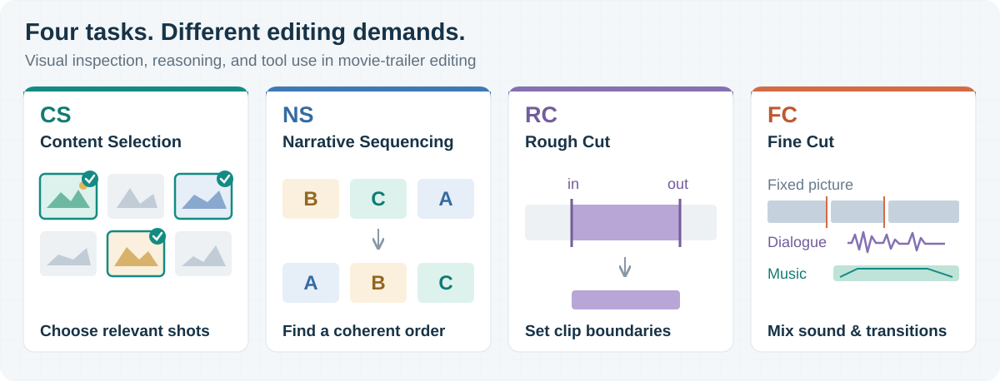
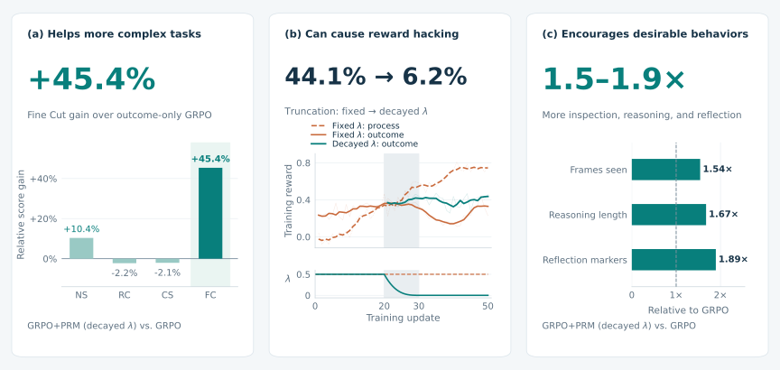

<div align="center">

<a href="docs/assets/film-poster-collage.png"></a>
<p><sub>49 real films · <a href="docs/poster_credits.md">Poster credits</a></sub></p>

<h1>When Fine-Grained Credit Assignment<br>Helps and Hurts</h1>
<p><strong>Multimodal Agentic Reinforcement Learning through Video Editing</strong></p>

<p>
<a href="mailto:leizhao7@upenn.edu">Lei Zhao</a><sup>1</sup> · <a href="mailto:tom@philolabs.ai">Zongheng Cao</a><sup>2</sup> · <a href="mailto:christine@philolabs.ai">Xinyu Hu</a><sup>2</sup>
</p>
<p>
<a href="https://www.upenn.edu/"></a> <sup>1</sup>University of Pennsylvania &nbsp;&nbsp; <a href="https://philolabs.ai/"><picture><source media="(prefers-color-scheme: dark)" srcset="https://philolabs.ai/brand/philo_icon_cream.svg"></picture></a> <sup>2</sup>Philo Labs
</p>
<p>
<a href="https://arxiv.org/abs/2610.35497"></a>
<a href="https://leizhao7.github.io/videoedit/"></a>
<a href="https://huggingface.co/collections/leizhao7/when-fine-grained-credit-assignment-helps-and-hurts-6ade523a0c5ce62251623b0d"></a>
<a href="LICENSE"></a>

</p>
<p>
<a href="#task-generation">🎬 Task generation</a> &nbsp;•&nbsp;
<a href="#agent-rl">🤖 Agent RL</a> &nbsp;•&nbsp;
<a href="#-findings">🔍 Findings</a> &nbsp;•&nbsp;
<a href="#-citation">📌 Citation</a>
</p>

</div>

**Teaching AI to Edit Video with 49 Real Films.** We turn movies and their trailers into video-editing tasks, then train multimodal agents to inspect footage, reason about editing decisions, and use editing tools. Evaluation on held-out films shows when finer-grained feedback helps or hurts task performance. This repository includes our scalable task-generation pipeline, RL training code, and outcome graders.

## 🎉 News

- **[2026-10-28]** Our [paper](https://arxiv.org/abs/2610.35497), [project website](https://leizhao7.github.io/videoedit/), code, and [VideoEdit models](https://huggingface.co/collections/leizhao7/when-fine-grained-credit-assignment-helps-and-hurts-6ade523a0c5ce62251623b0d) are publicly available.

<a id="task-generation"></a>

## 🎬 Turn Any Movie–Trailer Pair into RL Tasks

**Four editing task types, with grading included.** Start with a movie and its matching trailer. Our scalable pipeline aligns the footage, builds task briefs and media inputs, attaches outcome graders, and filters candidates through quality review.

<p align="center">
<a href="docs/assets/editing-tasks.svg"></a>
</p>

*The four task types are constructed independently. Fine Cut keeps picture and timing fixed.*

**Generate tasks from your own media.** Complete the [one-time setup](docs/workflow.md#1-set-up-once), replace the media paths below, and run from the repository root. Use a new project directory outside the checkout.

```bash
python video_editing.py init \
  --project "$HOME/video-editing-demo" \
  --movie '/path/to/movie.mkv' --trailer '/path/to/trailer.mp4' \
  --name myfilm --backend claude --model sonnet

python video_editing.py doctor --project "$HOME/video-editing-demo"
python video_editing.py run --project "$HOME/video-editing-demo"
```

**Output:** task folders in `training_task/myfilm/` and an **`accepted_tasks.json`** list of candidates that passed quality review, both inside your project. Each task includes its brief, media inputs, and private grading references.

Rerunning `run` reuses completed work. It can incur Modal and model usage. [Full walkthrough →](docs/workflow.md)

<details>
<summary>Backend options, progress, and smaller first reviews</summary>

- **Annotation backends:** Claude Code, Codex CLI, or OpenCode 1.x. Choose `--backend` and a model available to your account with `--model` at initialization; OpenCode uses `provider/model`. [Backend setup →](docs/agent_setup.md)
- **Preview or track progress:** use `run --plan` or `status` with the same `--project` path. The project's `README.md` links to stage logs.
- **Review a smaller batch:** append `--review-limit 1` to `run` to generate all candidates but review only one. Use `review --review-limit 5` for up to five additional candidates.
- **Stop before review:** `run --until tasks` builds candidates without Gemini quality review. `run --until probe` performs only a local media check.

</details>

<a id="agent-rl"></a>

## 🤖 RL for Long-Horizon Multimodal Agents

**Learn across long multimodal editing trajectories.** Our runtime combines **SkyRL** training, **vLLM** inference, and an **OpenCode agent harness** for repeated frame inspection, reasoning, and editing-tool use. Rollouts are configured for up to **100 turns** and **128K tokens of context**.

| Method | Credit-assignment granularity | Learning signal | Implementation |
| :--- | :--- | :--- | :--- |
| **Outcome-only GRPO** | Trajectory-level | Final task reward. | [Advantage construction](training/src/opencode_rl/training.py) |
| **GRPO+PRM** | Turn-level + trajectory-level | Process-judge rewards plus the final task reward, with optional process-weight decay. | [Process judge](training/src/prm_v2/judge_v5.py) · [Decay schedule](training/overlays/decay/prm_v2/live_config_v5.py) |
| **OPSD** | Token-level | Distillation from a frozen teacher given reference answers or turn suggestions. | [Distillation objective](opsd/examples/train/answer_self_distillation/topk.py) |

**Paper models:** **Qwen3.5-9B** for the main comparison; **Qwen3.6-35B-A3B** for additional GRPO/PRM experiments. [Experiment settings →](docs/experiment_notes.md)

**Run training.** After completing the [environment and task setup](docs/training.md#configure-and-deploy), select GRPO, GRPO+PRM or OPSD in your configuration:

```bash
export EDITING_TRAINING_CONFIG=/path/to/training.toml
python -m modal run training/modal_train.py --action check
python -m modal run training/modal_train.py --action smoke --steps 2
```

The smoke run uses **8 H200 GPUs** and at most two optimizer updates. The public GPU deployment remains unverified. [Full training guide →](docs/training.md) · [Offline CPU checks →](docs/training.md#run-the-offline-cpu-tests)

<details>
<summary>Source-only checks and repository layout</summary>

The static check uses Python 3.12. The optional real preparation regression also needs FFmpeg/FFprobe and the [CPU test dependencies](training/requirements-cpu.txt). These commands do not start training or call a model:

```bash
python scripts/check_release.py
PYTHONDONTWRITEBYTECODE=1 python -m unittest discover -s tests
```

```text
video_editing.py     Project setup, generation, review, and scoring
data_construction/   Task-generation stages and annotation backends
training/            GRPO/PRM runtime, decay overlay, and CPU tests
opsd/                Distillation objectives, teacher inputs, and adapters
evaluation/          Outcome graders and submission scoring
configs/             Recorded experiment settings and source identities
docs/                Setup guides, experiment notes, and paper figure
scripts/             Source-release verification
tests/               Offline source and interface regression checks
```

</details>

## 🔍 Findings

**1. Fine-grained feedback helps more complex tasks.** Decaying process rewards yields a **45.4% relative gain** over outcome-only GRPO on the more complex Fine Cut task. On the other three task types, outcome-only GRPO remains competitive, with at most a **10.4%** additional gain.

**2. Process rewards can lead to reward hacking.** With a fixed weight, process reward keeps rising while outcome reward declines after update 30. Decaying the weight to zero mitigates this behavior and reduces validation truncation from **44.1% to 6.2%**.

**3. Finer-grained feedback encourages desirable behaviors.** Compared with outcome-only GRPO, GRPO+PRM with decayed process rewards produces **more visual inspection, longer reasoning, and more frequent self-correction markers**. These changes accompany the highest overall task score in our comparison.

<p align="center">
<a href="docs/assets/findings-overview.svg"></a>
</p>

<details>
<summary>Scope and figure sources</summary>

These findings concern the tested methods and tasks. Task complexity, scoring criteria, and horizon vary together; the comparison does not isolate their individual effects. The process-reward findings concern LLM-judged turn-level rewards in GRPO+PRM; GiGPO and Turn-PPO are not evaluated. Longer reasoning and more self-correction markers do not establish reasoning quality or the correctness of corrections, and desirable behaviors alone do not ensure task completion.

[Figure sources and reading notes →](docs/experiment_notes.md#illustrations)

</details>

## 📌 Citation

If you use this work, please cite our [paper](https://arxiv.org/abs/2610.35497):

```bibtex
@misc{zhao2026finegrained,
  title         = {When Fine-Grained Credit Assignment Helps and Hurts: Multimodal Agentic Reinforcement Learning through Video Editing},
  author        = {Lei Zhao and Zongheng Cao and Xinyu Hu},
  year          = {2026},
  eprint        = {2610.35497},
  archivePrefix = {arXiv},
  primaryClass  = {cs.LG},
  url           = {https://arxiv.org/abs/2610.35497}
}
```

Machine-readable paper and software metadata are available in [`CITATION.cff`](CITATION.cff).

## 🙏 Acknowledgments and license

This implementation builds on **SkyRL**, **vLLM**, **OpenCode**, and **Qwen**. Recorded dependency identities are listed in [`configs/dependency_pins.json`](configs/dependency_pins.json).

Project-authored code is licensed under [MIT](LICENSE). Third-party components retain their own licenses; see [third-party notices](THIRD_PARTY_NOTICES.md). The paper figure, [poster artwork](docs/poster_credits.md), external media, and model weights are outside this code license.

Part of this work was completed while Lei Zhao was an intern at Philo Labs.

Contact: [Lei Zhao](mailto:leizhao7@upenn.edu) · [Zongheng Cao](mailto:tom@philolabs.ai) · [Xinyu Hu](mailto:christine@philolabs.ai).
