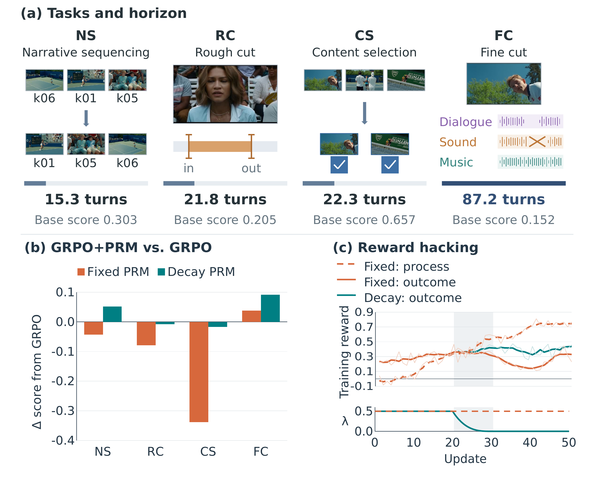

<div align="center">

# When Fine-Grained Credit Assignment<br>Helps and Hurts
### Multimodal Agentic Reinforcement Learning through Video Editing

**[Lei Zhao](mailto:leizhao7@upenn.edu)<sup>1</sup> · [Zongheng Cao](mailto:tom@philolabs.ai)<sup>2</sup> · [Xinyu Hu](mailto:christine@philolabs.ai)<sup>2</sup>**

<sup>1</sup> University of Pennsylvania &nbsp;&nbsp; <sup>2</sup> Philo Labs

[Overview](#overview) · [Findings](#what-we-learn) · [Quick start](#quick-start) · [Agent setup](#set-up-an-annotation-agent) · [Documentation](#documentation) · [Citation](#citation) · [License](#license)

</div>

We build a **scalable pipeline for generating video-editing tasks** from real films and their released trailers. The tasks reflect real editing workflows and support training and evaluation of multimodal agents.

**When does feedback on intermediate actions help—and when does it hurt task completion?** Using these tasks, we compare trajectory-, turn-, and token-level learning signals for agents that combine visual inspection, reasoning, and tool use.

<p align="center">
  <a href="docs/assets/paper-teaser.png"></a>
</p>

**Figure 1 · When process rewards help and hurt.** (a) Independent editing tasks, ordered by base-policy horizon; turns and base scores are task-type averages. (b) Final score differences from outcome-only GRPO. (c) Training rewards and the process-reward weight λ; shading marks the decay window over updates 20–30. [View full resolution](docs/assets/paper-teaser.png) · [Figure details](docs/experiment_notes.md#illustrations)

> **Repository status:** This is a research source snapshot in release preparation. Local source checks and selected CPU tests are available; a complete GPU training build and end-to-end reproduction have not yet been verified. [What is included and what remains →](docs/release_status.md)

## Overview

**Multimodal agentic RL.** Our experiments build on **SkyRL** for training, **vLLM** for generation, and an **OpenCode-based agent harness** for multi-turn visual inspection and video-editing tool use.

With **Qwen3.5-9B**, the paper compares **outcome-only GRPO**, **GRPO+PRM**, and **on-policy self-distillation (OPSD)** with either reference answers or turn suggestions as teacher-only information. We also ran **outcome-only GRPO** and **GRPO+PRM** with **Qwen3.6-35B-A3B** in additional experiments. [Training framework](docs/training.md) · [OPSD implementation](docs/opsd.md)

**Scalable data generation.** We develop a **data generation framework** that aligns trailer shots with source-film footage, divides trailers into narrative chunks, and generates editorial briefs. Each chunk yields four task types by varying the supplied media and required editing operation. These tasks are **constructed independently**: one task's output is not used to initialize the next.

Using our framework, we generated **2,352 video-editing tasks from 49 films**. Filtering and sampling retained **797 tasks: 716 for training and 81 for validation**, with no films shared between the two splits. Training on these tasks improved video-editing performance on held-out films. [Explore the task-generation pipeline →](docs/data_construction.md)

| Task | Editing decision |
| :--- | :--- |
| **CS** · Content Selection | Select relevant shots from a candidate pool. |
| **NS** · Narrative Sequencing | Arrange selected shots into a coherent sequence. |
| **RC** · Rough Cut | Set each clip's in- and out-points within a fixed sequence. |
| **FC** · Fine Cut | Select and trim dialogue, place music, choose transitions, and render the result. Picture and timing stay fixed. |

## What we learn

The main **Qwen3.5-9B** experiments show three patterns:

- **When it helps.** Decaying process rewards provides the largest benefit on Fine Cut. Outcome-only GRPO remains competitive on the three shorter-horizon task types. Task demands, scoring criteria, and horizon vary together, so this comparison does not isolate a causal effect of horizon.
- **When it hurts.** With a fixed process-reward weight, judge-preferred intermediate behaviors can increase while task completion and outcome scores decline. Reducing that weight to zero mitigates this pattern in our GRPO+PRM experiments.
- **Dense feedback is not sufficient.** OPSD is sensitive to the teacher's privileged information. Teacher–student disagreement and gradient statistics reveal contrasting failure patterns; effective remedies remain an open question.

These process-reward findings concern **LLM-judged turn-level rewards in our GRPO+PRM setup**. They do not establish the behavior of untested methods such as GiGPO or Turn-PPO. The full experimental context and implementation limits are summarized in the [experiment notes](docs/experiment_notes.md).

## Quick start

Start with **local source verification**. These commands need Python 3.12 and the standard library; they do not train a model, contact a judge, or allocate a GPU.

```sh
git clone https://github.com/leizhao7/video-editing-credit-assignment.git
cd video-editing-credit-assignment

python3 scripts/check_release.py
PYTHONDONTWRITEBYTECODE=1 python3 -m unittest discover -s tests -p 'test_release_tools.py'
```

The source check verifies syntax, source hashes, symlinks, and excluded artifact types. The tests exercise source assembly, manifest validation, and patch verification with temporary synthetic fixtures. Neither check establishes that the full training stack is installed or that benchmark scores can be reproduced.

**Next:** choose a component below. Its guide describes dependencies, supported checks, and the remaining runtime requirements.

### Set up an annotation agent

Task generation supports **Claude Code, Codex CLI, and OpenCode 1.x**. Pick the CLI you already use, install it, and sign in with its own login command. The setup wizard asks for your backend, an available model, and a private data directory:

```sh
python3 data_construction/setup_agent.py
```

It checks the CLI version and saves a separate configuration for each backend outside the repository. Copy the `source` command it prints to activate that configuration, then its check command to verify file reading, image viewing, and JSON output. The check makes a small real model call; setup alone does not.

Switch between saved configurations with one command, for example:

```sh
source ~/.config/video-editing-credit-assignment/codex.env
```

**[Installation, login, model selection, and troubleshooting →](docs/agent_setup.md)**

## Documentation

| I want to… | Guide | Source |
| :--- | :--- | :--- |
| Set up or switch an annotation agent | [Agent setup](docs/agent_setup.md) | [`setup_agent.py`](data_construction/setup_agent.py) |
| Explore the scalable task-generation pipeline | [Task generation](docs/data_construction.md) | [`data_construction/`](data_construction/) |
| Inspect GRPO and fixed/decayed process rewards | [Training](docs/training.md) | [`training/`](training/) |
| Inspect token-level self-distillation and teacher inputs | [OPSD](docs/opsd.md) | [`opsd/`](opsd/) |
| Understand outcome grading and aggregation | [Evaluation](docs/evaluation.md) | [`evaluation/`](evaluation/) |
| Find recorded settings and dependency identities | [Experiment notes](docs/experiment_notes.md) | [`configs/`](configs/) |
| Check reproduction gaps and release boundaries | [Release status](docs/release_status.md) | [`scripts/check_release.py`](scripts/check_release.py) |

<details>
<summary><strong>Repository map</strong></summary>

```text
data_construction/   Task-generation pipeline, adapters, and generic prompts
training/            Fixed-PRM source, separate decay overlay, and CPU tests
opsd/                Forward-KL recipe, teacher-input code, and adapters
evaluation/          Outcome graders and a separate decay overlay
configs/             Recorded settings, dependency pins, and source hashes
docs/                Component guides and paper figure
scripts/             Dependency-free source verification
tests/               Synthetic tests for release tools
```

</details>

## Data and reproducibility

The dataset is not distributed. The README includes the paper's Figure 1, with illustrative film thumbnails and aggregate results. Underlying film media, generated task instances, reference answers, cached trajectories, model checkpoints, and raw benchmark result files are not distributed.

The paper's four evaluation repetitions are **not four independent training seeds**. Recorded configurations and upstream commit IDs also do not reconstruct the original modified training environment. The missing environment builds, launch services, reference-answer OPSD snapshot, and final filtering/sampling procedure are tracked in [release status](docs/release_status.md).

## Citation

Author and software metadata are available in [`CITATION.cff`](CITATION.cff). A formal paper link and publication citation will be added when available.

Part of this work was completed while Lei Zhao was an intern at Philo Labs. For questions, contact [Lei Zhao](mailto:leizhao7@upenn.edu), [Zongheng Cao](mailto:tom@philolabs.ai), or [Xinyu Hu](mailto:christine@philolabs.ai).

## Acknowledgments

The implementation builds on OpenCode, SkyRL, vLLM, and Qwen3.5-9B. Exact identities are recorded in [`configs/dependency_pins.json`](configs/dependency_pins.json); local modifications must be considered alongside those pins.

## License

Project-authored code is licensed under the [MIT License](LICENSE). Third-party components retain their original licenses; see [third-party notices](THIRD_PARTY_NOTICES.md). The paper figure, external media, and model weights are not covered by this code license.
