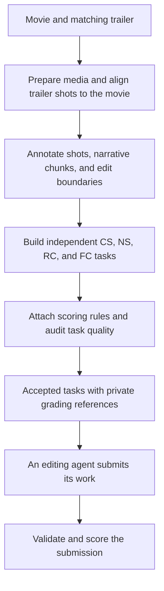

# From a movie and trailer to reviewed tasks

Use `video_editing.py` to create one private project, generate CS/NS/RC/FC tasks, attach their scoring rules, and review their quality. You provide a full movie and its matching trailer. The workflow saves progress so you can stop and continue without repeating completed work.

Generation produces tasks, not an agent's answers or performance scores. After an agent completes a task, the same entry point can check and score its submitted edit.

## How task generation works



| Stage | What happens | Implementation |
| --- | --- | --- |
| Prepare media | Inspect files, make a proxy, detect shot boundaries, transcribe speech, and separate dialogue/music | FFmpeg and local Python; TransNetV2, Whisper, and Demucs on Modal |
| Align footage | Locate trailer shots in the movie and refine source timings; keep unmatched footage identified separately | Programmatic visual matching and timing checks |
| Annotate structure | Inspect pictures, describe shots, group them into narrative beats and smaller editing chunks, and label edit boundaries | Your chosen Claude Code, Codex CLI, or OpenCode agent, followed by Python validation |
| Build tasks | Cut source clips and dialogue candidates, assemble assets and distractors, and write briefs, manifests, and private references | Python builders using measured media and annotations |
| Review quality | Check whether the public brief and supplied assets support the task and whether grading is fair | Gemini API audit; accept only completed `keep_candidate` decisions |
| Score submitted work | Validate deliverables, then run deterministic graders and RC/FC judges | Local scoring code and Gemini for the judged components |

Each chunk can yield four **independent** task types: CS selects shots; NS orders a supplied selection; RC chooses in/out points within a fixed order; FC edits dialogue, music, and transitions around fixed picture timing and renders the result. Eligibility filters can produce different counts across types. One task's output does not initialize another task.

The video and audio assets come from the supplied media. Models supply annotations, editing briefs, and quality judgments; they do not synthesize replacement movie footage. All newly authored instructions and explanations are requested in English. Original dialogue, visible card text, IDs, and proper names retain their source form. Compatibility rules still recognize historical Chinese annotations.

The default workflow performs quality filtering. Optional cross-film balancing and train/validation sampling use the separate [selection command](data_construction.md#quality-review-and-sampling); they are not run automatically for a one-film project.

## 1. Set up once

Use macOS or Linux with Python 3.12. You need FFmpeg/FFprobe, Tesseract with English data, a Modal account, one annotation CLI, and a Gemini API key for quality review and RC/FC scoring. A local GPU and DaVinci Resolve are not required.

Clone the repository, then install the Python dependencies in a separate environment:

```sh
git clone https://github.com/leizhao7/video-editing-credit-assignment.git
cd video-editing-credit-assignment

python3.12 -m venv "$HOME/.venvs/video-editing"
source "$HOME/.venvs/video-editing/bin/activate"
python -m pip install -r data_construction/requirements.txt \
  -r data_construction/requirements-modal.txt \
  -r evaluation/requirements.txt
```

Install the local media tools if needed:

```sh
# macOS, using Homebrew:
brew install ffmpeg tesseract

# Ubuntu/Debian, instead:
sudo apt-get install ffmpeg tesseract-ocr tesseract-ocr-eng
```

Run the appropriate line for your system, then check `ffmpeg -version`, `ffprobe -version`, and `tesseract --list-langs` (`eng` must be listed). Keep the requirements constraints: faster-whisper 1.2.1 needs PyAV below 19.

Authenticate Modal and install/sign in to **one** annotation CLI using the [agent setup guide](agent_setup.md#1-install-one-cli-and-sign-in):

```sh
modal setup

# Choose only the CLI you installed:
claude auth login
# or: codex login
# or: opencode auth login
```

Choose an annotation model with image input and tool use. Claude Code, Codex CLI, and OpenCode **1.x** are supported; OpenCode model IDs use `provider/model`. Existing native CLI logins are reused. The project workflow does not require the separate `setup_agent.py` profile wizard.

For Gemini calls, set the key in your shell environment:

```sh
export GOOGLE_AI_STUDIO_API_KEY='<your-Gemini-API-key>'
```

The annotation CLI and Gemini are separate connections. The key is not needed for `run --until probe`, construction through `run --until tasks`, or the default submission check with `score`. Keep credentials out of the project configuration and repository.

## 2. Create a private project

Use English media with English on the default audio track. Supply the matching film edition and trailer as `.mp4`, `.mkv`, or `.mov` files. The project directory must be new and outside the repository.

```sh
python video_editing.py init \
  --project "$HOME/video-editing-demo" \
  --movie '/path/to/movie.mkv' \
  --trailer '/path/to/trailer.mp4' \
  --name myfilm \
  --backend claude --model sonnet
```

Replace the paths and select a model available to your account. `--name` is a short ID containing up to 20 lowercase letters or digits. For another backend, change both `--backend` and `--model`; use `--cli '/path/to/executable'` or `--effort '<native-effort>'` when needed.

`init` fingerprints and links the input files, writes `project.json`, and assigns a dedicated Modal volume name. It does not copy or edit the original media or create cloud resources. Keep the input files in place. Reserve disk space for the proxy, extracted clips, audio, task bundles, and logs.

Select your Gemini models at initialization if the defaults are unavailable:

| Option | Default | Purpose |
| --- | --- | --- |
| `--quality-model` | `gemini-3.8-flash` | Review generated task quality |
| `--judge-model` | `gemini-3.1-pro-preview` | Score RC/FC submissions |
| `--annotation-timeout` | `1800` | Seconds per annotation invocation/batch |
| `--quality-timeout` | `600` | Seconds per quality-review HTTP operation |

Use Gemini models that support the required video/audio inputs. The annotation timeout is not a whole-film time limit; the quality timeout does not bound the entire audit batch.

## 3. Check, then generate

```sh
python video_editing.py doctor --project "$HOME/video-editing-demo"
python video_editing.py run --project "$HOME/video-editing-demo" --plan

# Optional local media check; no cloud or model calls:
python video_editing.py run --project "$HOME/video-editing-demo" --until probe

# Generate all candidates, then review just one to start:
python video_editing.py run --project "$HOME/video-editing-demo" --review-limit 1
```

`doctor` reports missing packages, executables, OCR language data, and configuration. It does not verify remote login, quota, or model access. Use `doctor --scope probe` to check only prerequisites for the local media probe, or `--scope build` before construction without Gemini review.

**`run` can incur Modal and model usage.** It preprocesses and aligns media, annotates shots and edits, extracts source dialogue, builds four task types, attaches scoring configuration, and reviews candidates. It creates the dedicated Modal volume automatically. The first run may download model weights and take substantial time.

Without `--review-limit`, `run` continues through review of every candidate. To generate tasks without calling the quality reviewer, use:

```sh
python video_editing.py run --project "$HOME/video-editing-demo" --until tasks
```

This still runs paid preprocessing and annotation. Other stopping points are `media`, `annotations`, and `dialogue`; `--until probe` is the local-only option.

## 4. Review progress and accepted tasks

```sh
python video_editing.py status --project "$HOME/video-editing-demo"

# Review up to five additional candidates, reusing completed reviews:
python video_editing.py review --project "$HOME/video-editing-demo" --review-limit 5

# Or review every remaining candidate:
python video_editing.py review --project "$HOME/video-editing-demo"
```

`--review-limit` bounds **new audits in that invocation**, not the total candidate count or accepted count. Interrupted or failed attempts count toward the limit when retried. A limited run can finish successfully with candidates still pending; inspect the review totals before calling the whole film reviewed.

The project's `README.md` provides step status and log links. Useful files are:

| File or directory | Contents |
| --- | --- |
| `training_task/myfilm/` | Candidate task folders: `s_1` = CS, `s_2` = NS, `s_3` = RC, `s_4e` = FC |
| `candidate_tasks.json` | All four types of generated tasks with scoring configuration |
| `accepted_tasks.json` | Candidates with a completed `keep_candidate` quality decision |
| `review_summary.json` | Per-task decisions, pending work, and whether all reviews are complete |
| `workflow/logs/` | Stage and review logs |

Review can recommend filtering, repairs, or more evidence. These outcomes and failed API requests do not enter the accepted list; original tasks are kept. Repairs are not applied automatically. A model's acceptance is a quality assessment, not proof that every annotation is correct. Read the per-task evidence linked from `review_summary.json` when investigating a decision.

To continue after interruption, rerun the same `run` or `review` command. Completed stages are checked and skipped, and completed reviews are reused after checking their bound inputs. A review that finished before the parent process saved progress is recovered from its receipt. Failed or unfinished reviews receive a new attempt when you explicitly rerun; they may incur usage again. The workflow stops on a failed stage and prints the log location.

Use a **new project** when changing input media, saved configuration, backend/model, or pipeline code/dependency declarations. The workflow rejects these changes for an existing project so earlier caches and review decisions are not silently reused. Changing task inputs after review also invalidates that review. Documentation and test-only edits do not change the pipeline identity.

## 5. Check and score an agent's edit

Generation does not run an editing policy. Give your agent a task's public `task_prompt.md` and `initial_state/` assets; keep `verifier/` reference material private. The agent must place the requested deliverables in that task's `output/` directory:

| Task | Deliverable |
| --- | --- |
| CS | `selection.json` |
| NS | `order.json` |
| RC | `cuts.json` |
| FC | `edit.json` and rendered `preview.mp4` |

Follow the task's prompt and manifest for the file contents. Then operate on the project's accepted-task list:

```sh
# Local submission validation; no API key or judge calls needed:
python video_editing.py score --project "$HOME/video-editing-demo"

# Evaluate submitted work; RC/FC call Gemini:
python video_editing.py score --project "$HOME/video-editing-demo" --execute
```

CS and NS use deterministic graders. RC combines deterministic checks and model judging; FC uses model judging. Results and log paths are printed and recorded in the project summary. Missing/invalid submissions are distinct from infrastructure failures or incomplete judge responses. `score --execute` starts a fresh evaluation each time; it does not resume a previous scoring batch, so repeating it can repeat paid judge calls. See [evaluation details](evaluation.md) for the scoring rules.

## Scope and further use

The component workflow has been exercised on a full film, with separate real quality-review and scoring checks. **The new unified entry point has not yet been rerun from raw media through all stages on a complete film.** The [validation record](release_status.md#one-film-construction-check) describes the exact evidence and limits. A successful run does not reproduce the paper's historical task-by-task author repairs or guarantee error-free model annotations.

The [manual one-film reference](one_film.md) documents the underlying commands. For a larger dataset, [quality review and deterministic sampling](data_construction.md#quality-review-and-sampling) explains how to declare film-level splits and balance retained tasks. The paper's 797-task count is not a target quota for a new film.

Keep the project private: it contains media, task instances, references, and model responses. The Modal volume persists after jobs finish; its name is in `project.json`. Remove your own volume through Modal only when you no longer need it.
